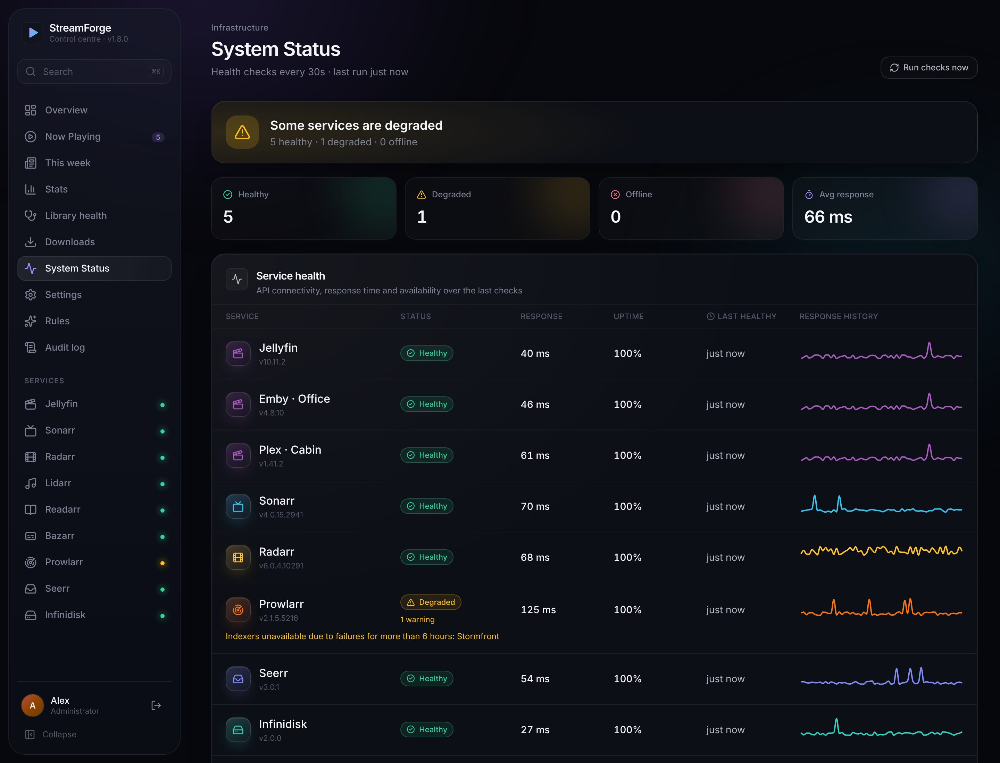
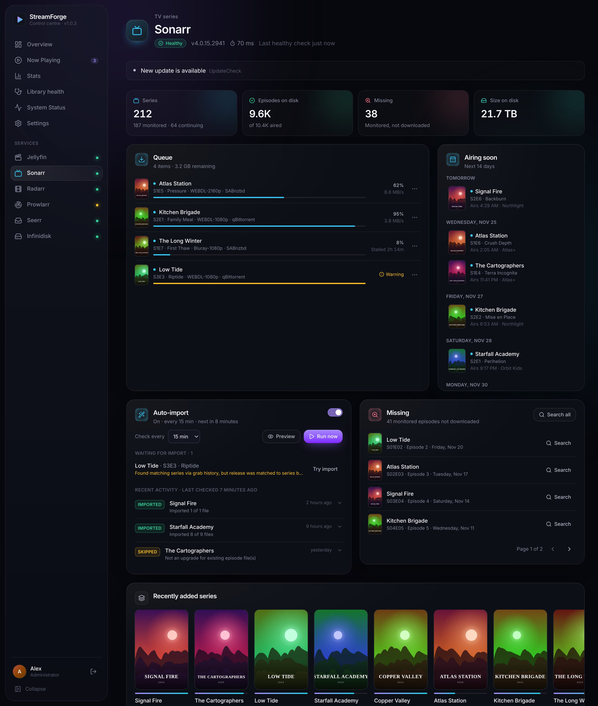
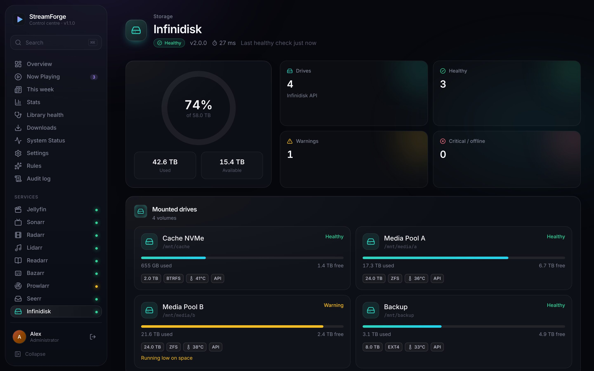
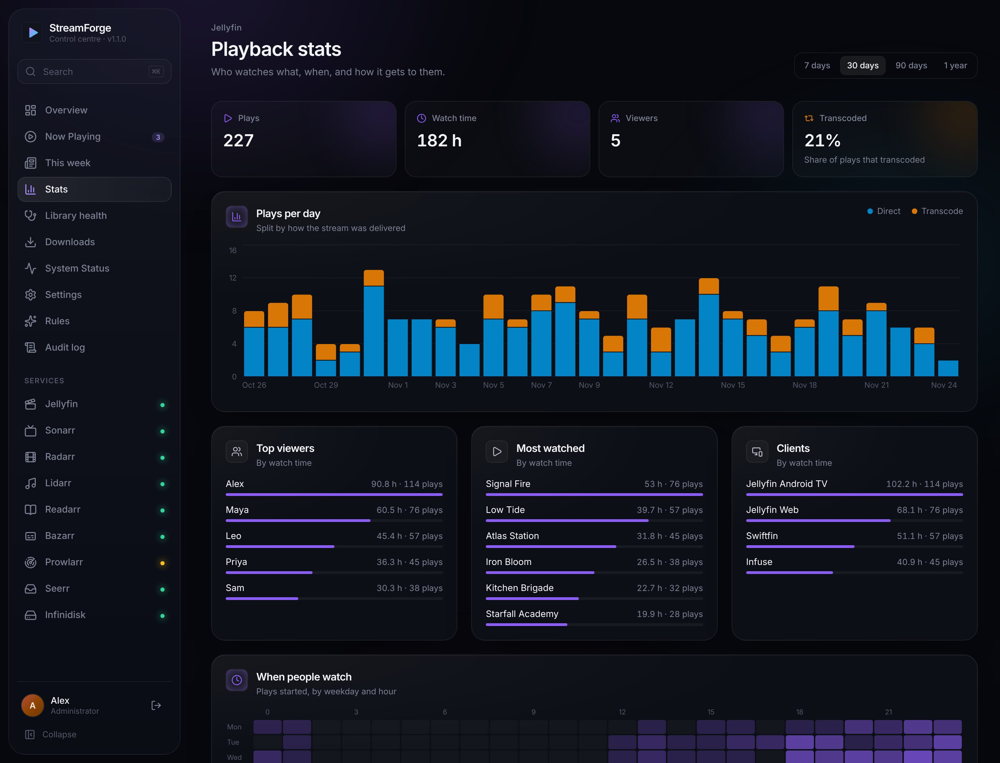
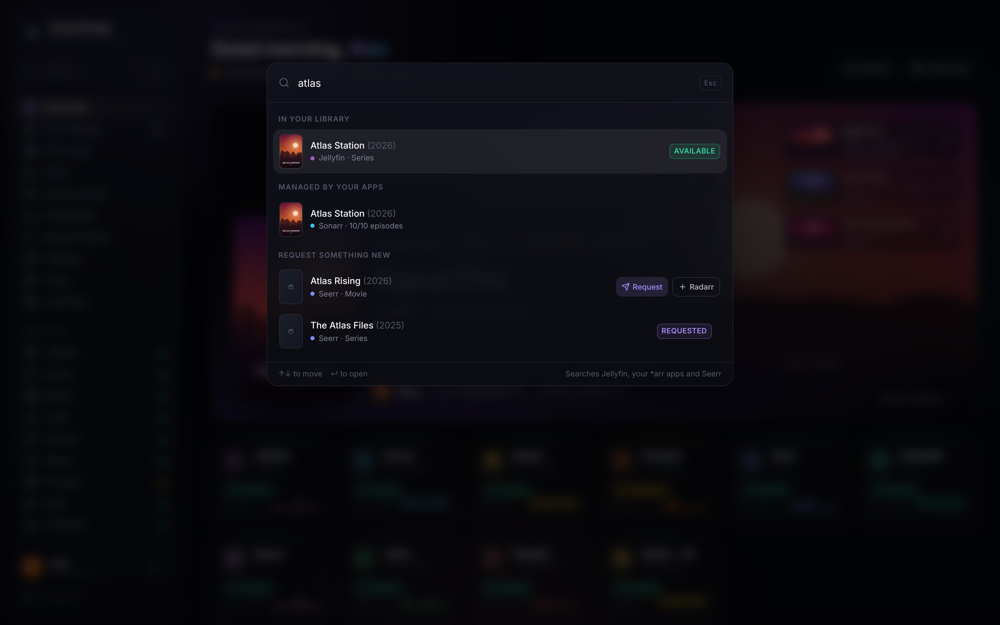
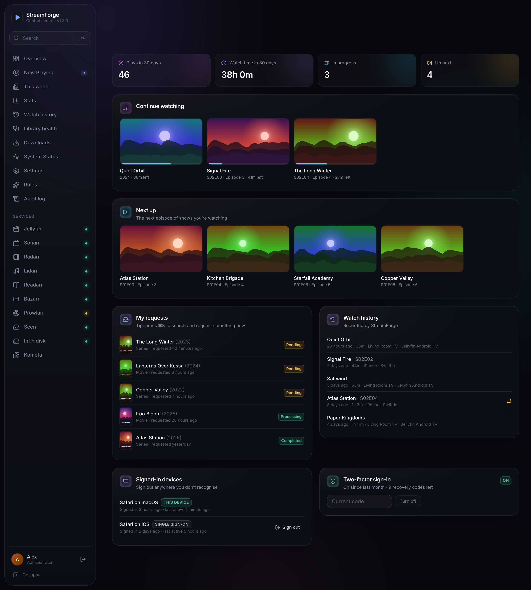
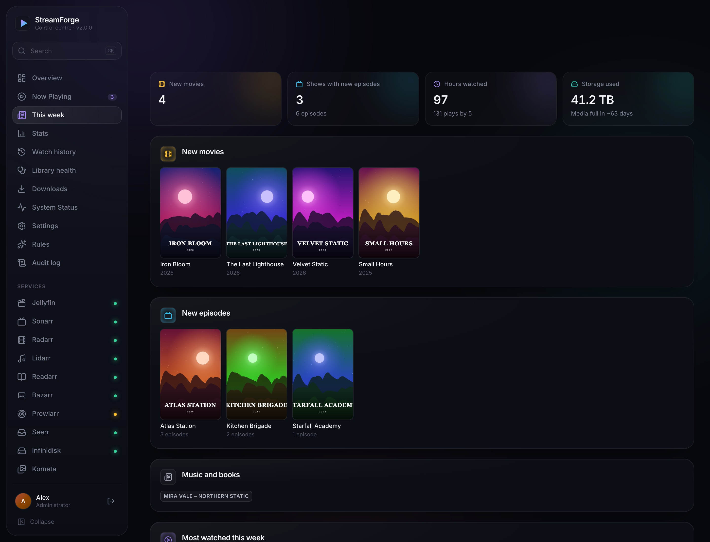
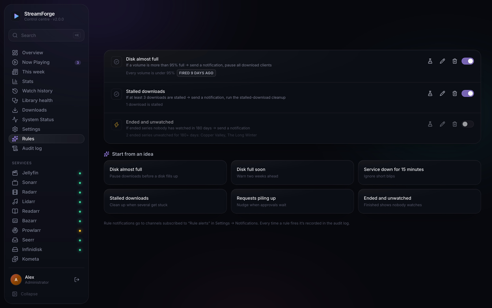

# StreamForge

A modern control centre for a Jellyfin media server and the services around it:
**Jellyfin, Sonarr, Radarr, Lidarr, Readarr, Bazarr, Prowlarr, Seerr,
Infinidisk and your download clients** (qBittorrent, Transmission, SABnzbd,
NZBGet). Run more than one media server? StreamForge can also watch extra
**Jellyfin, Emby and Plex** servers next to your main one.

Built with React, Vite, TypeScript and Tailwind CSS, with a small Node/Express
backend that handles authentication and keeps every service credential on the
server.

[**Website**](https://ashveebee.github.io/streamforge/) · [Install](#installation) · [Screenshots](#screenshots) · [Demo](#demo-mode) · [License](#license)


<sub>Screenshots use the built-in demo data. All titles, people and artwork are fictional.</sub>

## Screenshots

<table>
  <tr>
    <td width="50%"><a href="docs/screenshots/now-playing.jpg"></a><br><b>Now Playing.</b> Every stream on every media server, with direct play or transcode details.</td>
    <td width="50%"><a href="docs/screenshots/system.jpg"></a><br><b>System Status.</b> Health, response times and issues for each service.</td>
  </tr>
  <tr>
    <td><a href="docs/screenshots/jellyfin.jpg"></a><br><b>Media servers.</b> Libraries, users, server details and new additions, with a tab per Jellyfin, Emby or Plex server.</td>
    <td><a href="docs/screenshots/sonarr.jpg"></a><br><b>Sonarr and Radarr.</b> Queues with actions, auto-import, missing items and what's airing.</td>
  </tr>
  <tr>
    <td><a href="docs/screenshots/seerr.jpg"></a><br><b>Seerr.</b> Pending approvals and recent requests.</td>
    <td><a href="docs/screenshots/infinidisk.jpg"></a><br><b>Infinidisk.</b> Capacity, drive health and temperatures.</td>
  </tr>
  <tr>
    <td><a href="docs/screenshots/stats.jpg"></a><br><b>Stats.</b> Watch time, direct play vs transcode and who watches what.</td>
    <td><a href="docs/screenshots/library.jpg"></a><br><b>Library health.</b> Missing episodes, upgrades and items out of sync with Jellyfin.</td>
  </tr>
  <tr>
    <td><a href="docs/screenshots/downloads.jpg"></a><br><b>Downloads.</b> Real speeds and controls for your download clients.</td>
    <td><a href="docs/screenshots/search.jpg"></a><br><b>Search.</b> ⌘K searches everything and requests what's missing.</td>
  </tr>
  <tr>
    <td><a href="docs/screenshots/me.jpg"></a><br><b>Your page.</b> Continue watching, requests, history and devices.</td>
    <td><a href="docs/screenshots/digest.jpg"></a><br><b>Weekly digest.</b> What's new and what got watched.</td>
  </tr>
  <tr>
    <td><a href="docs/screenshots/rules.jpg"></a><br><b>Rules.</b> If this happens, do that.</td>
    <td><a href="docs/screenshots/audit.jpg"></a><br><b>Audit log.</b> Who changed what, and when.</td>
  </tr>
  <tr>
    <td><a href="docs/screenshots/bazarr.jpg"></a><br><b>Bazarr.</b> Missing subtitles with search buttons.</td>
    <td><a href="docs/screenshots/settings.jpg"></a><br><b>Settings.</b> Connect services, download clients, SSO and backups from the UI.</td>
  </tr>
  <tr>
    <td colspan="2"><a href="docs/screenshots/buffering.jpg"></a><br><b>Why did it buffer?</b> Spots streams that stalled and explains the likely cause, from the transcoder to your upload.</td>
  </tr>
</table>

## Features

- **Jellyfin sign-in.** Users sign in with their Jellyfin account. The server
  keeps the Jellyfin token, and the browser only holds an opaque HttpOnly session
  cookie. The user's profile and avatar come from Jellyfin.
- **Now playing.** Every active stream is shown with backdrop, poster, logo,
  title, season/episode, year, live progress, elapsed and remaining time, user,
  device and client. Each stream also shows direct play or transcode details:
  codecs, bitrate, hardware acceleration and transcode reasons. Admins can
  pause or resume a stream, send the viewer a message, or stop it with a reason.
- **Service integrations**
  - *Jellyfin:* server info, sessions, users, library statistics, recently added
    items, daily plays and the activity log.
  - *Media server discovery:* on first run, StreamForge lists the Jellyfin
    servers on your local network so you can pick one instead of typing its
    address. Under Settings → Jellyfin → More media servers, **Find on
    network** also finds Emby and Plex servers. It uses each server's own
    discovery: UDP port 7359 for Jellyfin and Emby, and Plex's GDM (UDP port
    32414, "Enable local network discovery" in Plex → Settings → Network). In
    Docker it only works with `network_mode: host`, because broadcasts don't
    leave a bridge network.
  - *More than one media server (Jellyfin, Emby and Plex):* add as many extra
    servers as you like under Settings → Jellyfin → More media servers. Pick
    the type, then enter the address and a key:

    | Type | Key |
    | --- | --- |
    | Jellyfin | API key from Dashboard → API Keys |
    | Emby | API key from Settings → Advanced → API Keys |
    | Plex | The server owner's Plex token (see Plex's help article "Finding an authentication token / X-Plex-Token") |

    Each server gets a health check and outage alerts on System Status, its
    streams on Now Playing (labelled with the server), and its own tab on the
    media server page with libraries, users, recently added and activity.
    Jellyfin and Emby streams can be paused, messaged and stopped. Plex
    streams can only be stopped, with a reason the viewer sees (stopping
    needs Plex Pass). Plex has no activity log, so its tab shows recent plays
    from Plex's watch history instead. Sign-in, title pages, stats, playback
    alerts and the buffering diagnosis use the main Jellyfin server, so a
    Jellyfin server is still needed to sign in.
  - *Sonarr:* series stats, queue, airing calendar and disk space, plus a
    missing-episodes list with search buttons.
  - *Radarr:* movie stats, queue, cinema/digital/physical release dates,
    quality breakdown and disk space, plus a missing-movies list with search
    buttons.
  - *Sonarr and Radarr queues:* admins can blocklist and search again,
    blocklist, remove (with or without deleting the download) or grab a
    delayed release now. Queue rows show how long a download has been stalled.
  - *Multiple instances:* add extra Sonarr/Radarr instances (a 4K Radarr, an
    anime Sonarr) under the main service in Settings. Each gets its own tab,
    health check and place in the queues, calendar and download charts.
  - *Prowlarr:* health, query/grab/failure stats and response time for each
    indexer, plus connected apps.
  - *Seerr:* request counts by status, pending approvals and recent requests,
    with TMDB artwork. Admins can approve or decline requests from the Seerr
    page or the dashboard.
  - *Infinidisk:* drives, capacity, usage, temperature and health.
  - *Lidarr and Readarr:* library stats, download queue (remove and
    blocklist), upcoming releases, and missing albums or books with search
    buttons.
  - *Bazarr:* episodes and movies missing subtitles, with per-title and bulk
    searches, plus recent subtitle activity.
  - *Jellyfin maintenance:* admins can scan all libraries or one, refresh a
    library's metadata, and run or stop Jellyfin's scheduled tasks.
- **System status.** A background monitor checks every service on an interval
  and records:
  - healthy, degraded or offline status;
  - response time and its history;
  - uptime over the recent checks;
  - the last successful check;
  - issues the service reports about itself.

  It also shows host CPU, RAM, network and filesystems, computes download
  throughput, and forecasts storage: disk usage is recorded hourly and a trend
  through the last 30 days estimates when each volume will be full.
- **Playback stats.** A Stats page shows plays per day split by direct play vs
  transcode, watch time, top viewers, titles and clients, and a weekday-by-hour
  heatmap. Watch time and transcode figures need a Jellyfin API key (see
  *Notes on data sources*).
- **Library health.** Cross-checks Sonarr, Radarr and Jellyfin by TVDB/TMDB/IMDb
  id. It lists monitored series with missing episodes, files that could be
  upgraded (with a search button), downloads Jellyfin doesn't have, and Jellyfin
  items no Sonarr/Radarr instance manages.
- **Customisable dashboard.** Drag widgets to reorder them, resize them (⅓, ½, ⅔
  or full width), or hide them. The layout is saved per user on each device.
- **Settings in the UI.** Connect services from a Settings page with a
  connection test for each one. Changes apply instantly and are stored in a
  local SQLite database. No config files to edit. Services you don't use can
  be switched off; they're hidden from the sidebar and dashboard and never
  contacted, and their settings are kept for later.
- **Auto-import (Sonarr and Radarr).** Finds finished downloads that couldn't
  be imported (for example "Unknown Series", "Unable to parse" or "matched by
  ID") and imports them. For each file it uses the first answer it can get:
  - **Series or movie:** the app's own match, then what the release was grabbed
    for, then the app's release-name parser, then a strict title match against
    your library (including alternate titles). Movies must also match on year.
  - **Episodes:** season and episode, absolute or air-date numbering.

  It skips a file when the signals conflict, when the file is a sample, when a
  movie download holds several video files, or when the app would still reject
  it (for example "not an upgrade"). It runs on a schedule, shortly after a
  download gets stuck, or when you press **Run now**. **Preview** shows what it
  would do without changing anything. It is off by default; turn it on from
  the Sonarr or Radarr page.
- **Stalled download cleanup.** When turned on (System page), downloads with no
  progress for a chosen time, and optionally ones the client reports as failed,
  are removed, blocklisted and searched for again. At most 10 per sweep.
- **Notifications.** Send alerts to Discord, ntfy, Pushover, any webhook
  (optionally HMAC-signed) or straight to your phone or browser with web push.
  Pick events per channel: service offline or back, disk almost full, imports
  done or failed, stalled downloads removed, and new requests to approve.
- **Member access.** Let non-admin Jellyfin users sign in and choose which
  pages they see. Access is enforced by the server, and every action stays
  admin-only.
- **Download clients.** Connect qBittorrent, Transmission, SABnzbd or NZBGet
  for real transfer speeds and a Downloads page listing everything in each
  client. Admins can pause and resume, remove (with or without files) and set
  speed limits.
- **Global search.** Press ⌘K / Ctrl+K (or `/`) to search Jellyfin, every
  Sonarr/Radarr instance, Lidarr and Readarr at once, and jump to any page.
  New titles come from Seerr, where people can request them in their own
  name; admins can also add a title straight to Sonarr or Radarr.
- **Your own page.** Everyone gets a page (click your name in the sidebar)
  with continue watching, next up, watch history, their Seerr requests,
  signed-in devices and two-factor settings.
- **Weekly digest.** A "This week" page shows what was added and what got
  watched. Admins can send it every week through the notification channels.
- **Will it play on your devices?** Every play teaches StreamForge what
  that device can handle: which file types, video and audio formats, HDR
  and subtitles it plays directly, and which make Jellyfin convert (from
  Jellyfin's own transcode reasons). From that it predicts, for any file,
  whether a device plays it directly, needs it repackaged, converts the
  audio, or converts the video (the heavy one).
  - Title pages show **Will it play?** for each device people watch on,
    with the reason and, for movies with several versions, which version
    to use.
  - Library health shows how the whole library plays on each device: how
    much plays directly, what makes the rest convert ("Dolby TrueHD audio:
    21 files") and which titles are affected.
  Profiles build up from new plays (a few plays per device is enough to
  start). Admins only; needs a Jellyfin API key.
- **Cleanup suggestions.** Library health lists big movies and series nobody
  has watched in 3–24 months, with the space each would free. Keep, stop
  monitoring, or delete them from there.
- **Transcode and bandwidth alerts.** Get alerted when too many streams
  transcode at once, total bandwidth passes a limit, or a 4K file is being
  transcoded (optionally messaging the viewer).
- **Buffering diagnosis.** StreamForge records every stream, the host's CPU
  and network, download client speeds and Jellyfin's response time every 15
  seconds, and keeps three days. It spots streams that fell behind real time
  while not paused and explains the likely cause, with evidence and what to
  try:
  - Jellyfin converting slower than real time (with its transcode reasons
    and whether hardware acceleration is on);
  - a maxed-out CPU;
  - a full internet upload for viewers away from home, split into streams
    and torrent seeding;
  - a video bitrate the connection can't carry;
  - downloads running flat out, or Jellyfin slow or not responding.
  When nothing on the server stands out, it says so: the cause is then the
  viewer's Wi-Fi, connection or device. When someone reports buffering, pick
  their stream and roughly when, and StreamForge finds the nearest stall.
  Open it from **Why did it buffer?** on the Now Playing page (admins only;
  needs a Jellyfin API key). Set your upload speed on the page for
  sharper results (otherwise the highest upload seen is used).
- **Rules.** Simple automations: if a disk is nearly full, pause the download
  clients; if downloads stall, run the cleanup; if a service stays down,
  notify; and more. Rules never delete anything.
- **Audit log.** Every change made through StreamForge — settings, approvals,
  stream controls, queue actions, sign-ins — with who did it and from where.
- **Single sign-on and two-factor.** Sign in through any OpenID Connect
  provider (Authentik, Authelia, Keycloak, Pocket ID, …), and turn on
  two-factor sign-in with an authenticator app.
- **Update notices.** Admins see when a new StreamForge release is out, with
  what changed since their version and how to update.
- **Backup and restore.** Download all settings as one encrypted file and
  restore it on another server from Settings.
- **Installable.** StreamForge is a progressive web app: install it on a phone
  or desktop, and the app shell opens offline. Web push needs HTTPS.
- **Real-time updates.** Each endpoint is polled at a cadence that suits its
  data. Playback progress advances every second between polls. The backend
  de-duplicates upstream calls across clients.

## Installation

StreamForge runs as a single Docker container (images for `amd64` and `arm64`).
All you need is Docker and a Jellyfin server it can reach.

### 1. Start the container

**Docker Compose** (recommended). Save this as `docker-compose.yml`, or download
[`docker-compose.example.yml`](docker-compose.example.yml):

```yaml
services:
  streamforge:
    image: ghcr.io/ashveebee/streamforge:latest
    container_name: streamforge
    ports:
      - "4000:4000"
    volumes:
      - streamforge-data:/data
    restart: unless-stopped

volumes:
  streamforge-data:
```

```bash
docker compose up -d
```

**Or with `docker run`:**

```bash
docker run -d --name streamforge \
  -p 4000:4000 \
  -v streamforge-data:/data \
  --restart unless-stopped \
  ghcr.io/ashveebee/streamforge:latest
```

The `/data` volume holds the settings database. Keep it, or you'll need to set
everything up again after an upgrade.

### 2. Connect Jellyfin

Open **http://your-server:4000**. On first launch StreamForge asks for your
Jellyfin server address (for example `https://jellyfin.example.com` or
`http://192.168.1.10:8096`). It checks that the server is reachable, then you
sign in with a **Jellyfin administrator** account.

### 3. Connect your other services

Go to **Settings** in the sidebar. For each service you use, enter its address
and API key, click **Test connection**, then **Save**. Changes apply
immediately; no restart is needed. Skip any service you don't run.

| Service | Where to find the API key |
| --- | --- |
| Jellyfin | Dashboard → API Keys (optional; enables server-wide stats and update warnings) |
| Extra Emby server | Emby → Settings → Advanced → API Keys (Settings → Jellyfin → More media servers) |
| Extra Plex server | The server owner's Plex token (Settings → Jellyfin → More media servers) |
| Sonarr / Radarr / Prowlarr | Settings → General → Security → API Key |
| Seerr | Settings → General → API Key |
| Lidarr / Readarr / Bazarr | Settings → General → Security → API Key |
| qBittorrent / Transmission / NZBGet | Your web UI username and password (Settings → Download clients) |
| SABnzbd | Config → General → API Key (Settings → Download clients) |
| Infinidisk | Your Infinidisk settings (optional if its status endpoint is public) |

> **Addresses are resolved from inside the container.** `localhost` means the
> StreamForge container itself, not your host. Use your server's LAN IP or
> domain name, `http://host.docker.internal:<port>` for services on the same
> host (Docker Desktop; on Linux add `--add-host=host.docker.internal:host-gateway`),
> or the container name (e.g. `http://sonarr:8989`) if the services share a
> Docker network with StreamForge.

### Updating

```bash
docker compose pull && docker compose up -d
```

Your settings are kept in the `streamforge-data` volume. See
[Releases and image tags](#releases-and-image-tags) to pin a version instead of
following `latest`.

StreamForge tells admins when a new release is out: the sidebar shows the new
version, and **Settings → Updates & backup** lists what changed since your version and
the command to update. It asks GitHub's public API every 6 hours, sending
nothing but its version number. Pick **StreamForge update available** on a
notification channel to hear about it there too, or set `UPDATE_CHECK=false`
to turn the check off.

### Backing up

The easiest way is **Settings → Backup & restore**: it downloads every setting
as one file encrypted with a passphrase, and restores it on any StreamForge
server (in Docker, StreamForge restarts itself to apply it).

Everything StreamForge stores is in `/data/streamforge.db`. To back up the whole
volume instead:

```bash
docker run --rm -v streamforge-data:/data -v "$PWD":/backup alpine \
  tar czf /backup/streamforge-data.tgz -C /data .
```

The file contains your service API keys, so keep backups private.

### Public addresses

StreamForge usually reaches your services on internal addresses such as
`http://jellyfin:8096`, which don't work from your phone. Set a **Public
address** on a service in Settings (or `JELLYFIN_PUBLIC_URL`,
`SONARR_PUBLIC_URL` and so on) to the address you open it at in a browser,
for example `https://jellyfin.example.com`. Links such as **Play in
Jellyfin** and **Open in Sonarr** then use it.

### Moonfin

If you use [Moonfin](https://github.com/Moonfin-Client), switch it on in
**Settings → Moonfin**. Play buttons then offer to open titles in the Moonfin
app (`moonfin://` links) or the Moonfin web app that its Jellyfin plugin serves
at `/Moonfin/Web/`. Each device asks once and can remember the answer, and the
arrow next to Play lets anyone pick again. The web app uses Jellyfin's public
address.

### Optional: configure with environment variables

Everything can also be set with environment variables, which is handy for
infrastructure-as-code. Copy [`.env.example`](.env.example) to `.env`, fill in
what you need and pass it with `--env-file .env` (Compose picks up `.env`
automatically if you use the example file). Settings saved in the UI take
precedence. **Use environment** on a service in Settings removes the saved
copy and falls back to the variables.

Server options such as `PORT`, `TRUST_PROXY` (set when behind a reverse proxy)
and `SESSION_TTL_HOURS` are environment-only. `ALLOW_NON_ADMIN` sets the
default for **Member access** in Settings. See `.env.example` for the full list.

### Troubleshooting

- **"Jellyfin server unreachable" or a failed connection test:** check the
  address from inside the container:
  `docker exec streamforge wget -qO- <url>/System/Info/Public`.
- **"Unauthorised — check API key":** the key is wrong or was regenerated.
  Paste it again in Settings. For Plex, use the token of the account that owns
  the server: a shared user's token can't see sessions or history.
- **Plex says "Plex can only stop streams":** Plex doesn't let a server pause
  a stream or send the viewer a message. Stopping works with Plex Pass.
- **"Find on network" doesn't find Plex or Emby:** turn on "Enable local
  network discovery (GDM)" in Plex (Settings → Network). In Docker, use
  `network_mode: host`. You can always add a server by its address.
- **"Re-enter the API key when changing the server address":** a saved key is
  never sent to a new address. Paste the key again along with the new address.
- **Locked out after changing the Jellyfin server:** this is expected, because
  everyone is signed out. Sign in again with an administrator account on the
  new server.
- **Lost your two-factor device and recovery codes:** another admin can reset
  it under Settings → Sign-in security. If you're the only admin, start the
  container once with `STREAMFORGE_RESET_2FA=<your Jellyfin user name>`, sign
  in, and remove the variable again.
- **Single sign-on says there's no Jellyfin user:** the username claim
  (`preferred_username` by default) must match a Jellyfin user name. Change the
  claim under Settings → Sign-in security if your provider sends something else.
- **Logs:** `docker logs streamforge`. The startup banner lists every service
  and where its settings come from.

## Development

Requires Node.js 22.13 or newer.

```bash
npm install
npm run dev               # API on :4000, UI on :5173 (proxied)
```

Settings are stored in `./data` (git-ignored).

### Demo mode

To try the UI without any media services:

```bash
npm run demo              # UI on http://localhost:5173, already signed in
```

This runs a mock API (`scripts/demo-server.ts`) with fictional streams,
libraries, queues and requests, and generated artwork. To re-create the README
screenshots after changing the UI, keep the demo running and run
`./scripts/screenshots.sh` (needs Google Chrome).

### Production build

For a production build without Docker:

```bash
npm run build
npm start                 # serves UI + API on :4000
```

## Releases and image tags

StreamForge follows [Semantic Versioning](https://semver.org). Releases are
automated from [Conventional Commits](https://www.conventionalcommits.org/)
(see [CONTRIBUTING.md](CONTRIBUTING.md)), and each one is published as a
[GitHub Release](../../releases) with a changelog.

| Tag | Updated when | Use it for |
| --- | --- | --- |
| `1.2.3` | never (immutable) | exact, reproducible deployments |
| `1.2` | every patch release of 1.2 | bug fixes only |
| `1` | every 1.x release (from 1.0.0) | **recommended** once 1.0 is out: features and fixes, no breaking changes |
| `latest` | every release | always the newest stable release |
| `edge` | every commit to `main` | testing unreleased changes |
| `sha-abc1234` | that commit only | debugging a specific build |

Every image ships with an SBOM and a signed build-provenance attestation. To
verify an image:

```bash
gh attestation verify oci://ghcr.io/ashveebee/streamforge:1 --repo ashveebee/streamforge
```

The running version appears in the sidebar and at `/healthz`.

## Architecture

```
browser ──(session cookie)──▶ StreamForge server ──(API keys / Jellyfin token)──▶ services
         /api/*                 server/                                     Jellyfin, *arr, Seerr, Infinidisk
```

```
server/
  index.ts            Express app, security headers, static hosting
  config.ts           zod-validated environment configuration
  settings.ts         runtime service settings (SQLite, falling back to env)
  settingsRoutes.ts   admin Settings API: view, test, save, reset
  auth.ts             Jellyfin login/logout, first-run setup, session middleware, CSRF guard
  routes.ts           /api routes and image proxies
  health.ts           health monitor and download-throughput sampler
  host.ts             host CPU / RAM / network / filesystem metrics
  services/           one module per integration (normalises upstream data)
  lib/                http client, TTL cache, session store, SQLite database
src/
  pages/              one page per route
  components/widgets  dashboard widgets and widget registry
  components/ui       design-system primitives (cards, gauges, states, charts)
  components/layout   shell, collapsible sidebar, headers
  hooks/              react-query hooks, auth context, persisted state
  lib/                API client, formatters, shared types
```

To add an integration:

1. Add a module in `server/services/` that reads its client via `derived()` from
   `server/settings.ts`, and add the service to `SERVICE_IDS` and the Settings page.
2. Register its probe in `server/health.ts`.
3. Expose a route in `server/routes.ts`.
4. Add a hook in `src/hooks/queries.ts`.
5. Add a widget to `src/components/widgets/registry.tsx`.

## Security

- API keys stay on the server, in the environment or the settings database
  (`chmod 600`, in an owner-only directory). The Settings page shows only the
  last four characters of a saved key, and only administrators can open it.
- A saved API key is never sent to a new server address: changing a service's
  address requires entering its key again.
- First-run setup (choosing the Jellyfin server) is only available while no
  Jellyfin server is configured. Changing the Jellyfin server later signs
  everyone out.
- Artwork is streamed through validated proxy routes, so the browser never
  contacts internal services. Item IDs, image types and cover filenames are
  checked against allow-lists to prevent SSRF.
- Session cookies are random 256-bit IDs, `HttpOnly` and `SameSite=Strict`.
  They are `Secure` when the request arrives over HTTPS.
- Jellyfin tokens are re-checked every 5 minutes. Revoking a device or demoting
  a user in Jellyfin ends their StreamForge session.
- State-changing requests require a custom header, which acts as CSRF
  protection. Login is rate-limited, and Helmet sets the CSP and other headers.
- Only Jellyfin administrators can sign in by default. Turn on **Member access**
  in Settings (or set `ALLOW_NON_ADMIN=true`) to let other users in. Members
  only reach the pages you allow, checked on the server, and can't change
  anything.
- Notification secrets (webhook URLs, tokens) are stored on the server and
  never sent back to the browser.
- Sessions are stored in the settings database, so restarts and upgrades keep
  people signed in. Everyone can see and sign out their own devices.
- Two-factor sign-in uses standard authenticator-app codes with ten
  single-use recovery codes. Codes can't be reused, and attempts are
  rate-limited.
- Single sign-on uses the OpenID Connect code flow with PKCE and checks the ID
  token's signature against the provider's keys. It needs a Jellyfin API key,
  because there is no Jellyfin password to sign in with.
- Backups are encrypted with your passphrase (scrypt and AES-256-GCM) and never
  include sign-in sessions.
- Every change and sign-in is recorded in the audit log for 180 days.

## Notes on data sources

- **Features that need the Jellyfin API key.** Transcode alerts, the weekly
  digest notification, single sign-on, the active-streams and ended-series
  rules, and watch history all work in the background, so they use the
  Jellyfin API key (Settings → Jellyfin).
- **Cleanup suggestions** count a title as watched when any Jellyfin user has
  played or started it, or StreamForge recorded a play. Results are cached for
  ten minutes.
- **Playback stats.** With a Jellyfin API key set (Settings → Jellyfin), a
  recorder samples active sessions every 30 seconds and stores each play,
  including watch time and whether it transcoded. Without a key, or for days
  before recording started, the Stats page uses Jellyfin's activity log, which
  has plays but no watch time or transcode data.
- **Storage forecast.** Usage is sampled hourly from Infinidisk, the host and
  Sonarr/Radarr; volumes seen by several of them are counted once. A forecast
  appears after a day of history.

- **Download speeds.** Sonarr and Radarr don't report a live speed, so
  StreamForge works it out from how much each queue item's remaining size drops
  between samples, taken every 5 seconds.
- **Playback activity chart.** This is built from Jellyfin's activity log
  (`VideoPlayback` and `AudioPlayback` entries). No plugin is needed.
- **Extra Emby and Plex servers.** Emby shares Jellyfin's API, so StreamForge
  reads it the same way (under Emby's `/emby` path, with the `X-Emby-Token`
  header). Plex is read through its own API (`server/services/plex.ts`): active
  streams from `/status/sessions`, libraries and counts from
  `/library/sections`, users from `/accounts`, recent plays from
  `/status/sessions/history/all` and artwork through Plex's photo transcoder.
  Plex user avatars live on plex.tv, so Plex users show initials instead.
- **CPU, RAM and network.** These figures come from the machine running the
  StreamForge server. Run it on the media server, with host networking in
  Docker, to see that server's figures.
- **Infinidisk.** The adapter in `server/services/infinidisk.ts` accepts either
  or both of these sources:
  - a JSON status endpoint (`INFINIDISK_URL` + `INFINIDISK_STATUS_PATH`). It reads
    the common response shapes: a `drives`, `disks`, `mounts`, `volumes` or
    `pools` array whose entries have size, used and free values in bytes, plus a
    health or status field;
  - local mount points, listed in `INFINIDISK_MOUNTS`, which it measures directly.

  If your Infinidisk API uses different field names, extend `normaliseRemote()`.
- **Self-signed TLS.** If a service uses a self-signed certificate, point
  `NODE_EXTRA_CA_CERTS` at your CA bundle.

## License

StreamForge is free and open source software, licensed under the
[GNU General Public License v2.0](LICENSE), the same license as Jellyfin.

- ✅ Use it for anything, at home or at work, commercially or not
- ✅ Study it, change it and share your changes
- 📄 If you distribute StreamForge or a modified version, you must make the
  source code available under the same license

```
StreamForge
Copyright (C) 2026 ashveebee and contributors

This program is free software; you can redistribute it and/or modify it under
the terms of the GNU General Public License version 2 as published by the Free
Software Foundation.

This program is distributed in the hope that it will be useful, but WITHOUT ANY
WARRANTY; without even the implied warranty of MERCHANTABILITY or FITNESS FOR A
PARTICULAR PURPOSE. See the GNU General Public License for more details.
```
