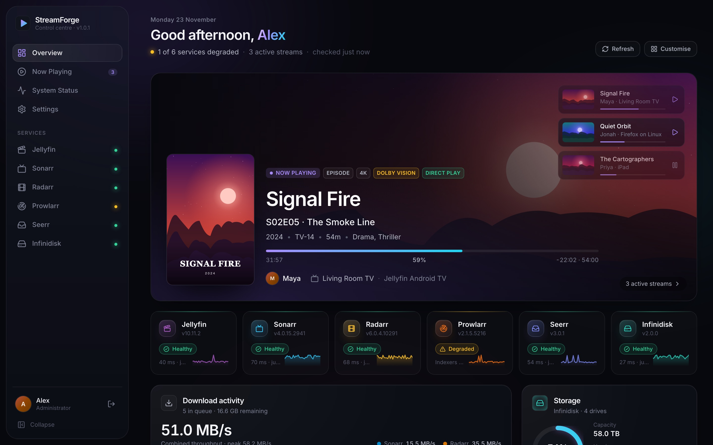
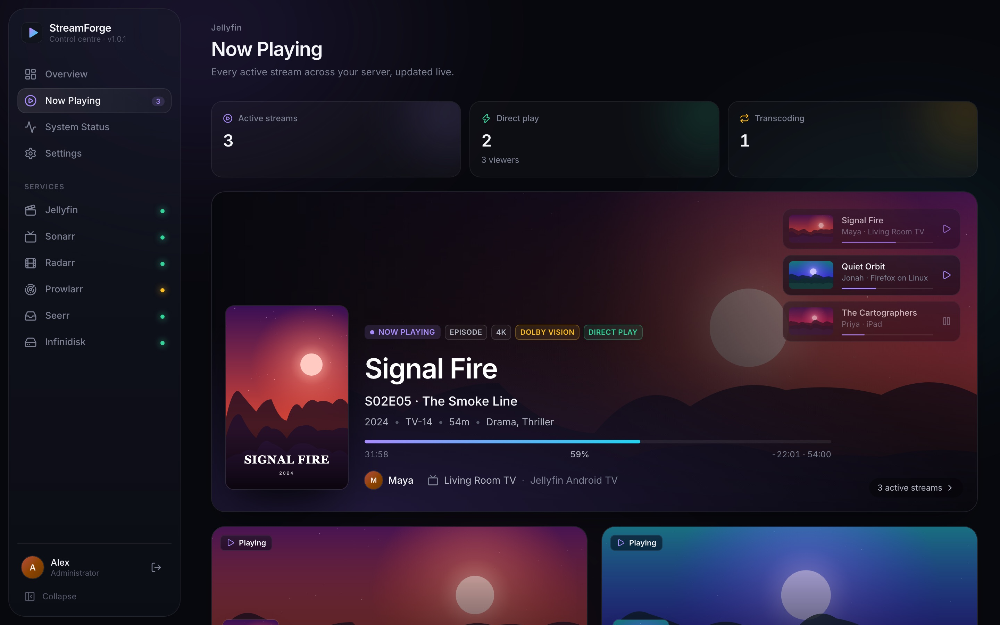
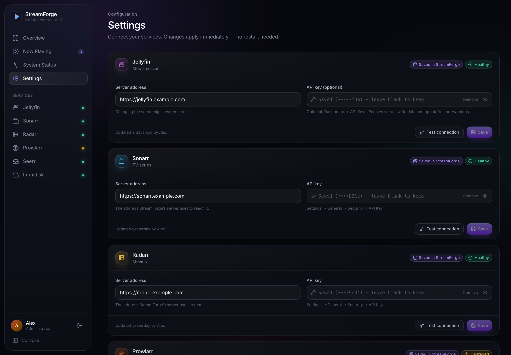

# StreamForge

A modern control centre for a Jellyfin media server and the services around it:
**Jellyfin, Sonarr, Radarr, Prowlarr, Seerr and Infinidisk**.

Built with React, Vite, TypeScript and Tailwind CSS, with a small Node/Express
backend that handles authentication and keeps every service credential on the
server.



<sub>Screenshots use the built-in demo data. All titles, people and artwork are fictional.</sub>

## Screenshots

<table>
  <tr>
    <td width="50%"><a href="docs/screenshots/now-playing.jpg"></a><br><b>Now Playing.</b> Every stream, with direct play or transcode details.</td>
    <td width="50%"><a href="docs/screenshots/system.jpg"></a><br><b>System Status.</b> Health, response times and issues for each service.</td>
  </tr>
  <tr>
    <td><a href="docs/screenshots/jellyfin.jpg"></a><br><b>Jellyfin.</b> Libraries, users, server details and new additions.</td>
    <td><a href="docs/screenshots/sonarr.jpg"></a><br><b>Sonarr and Radarr.</b> Queues, upcoming releases and disk space.</td>
  </tr>
  <tr>
    <td><a href="docs/screenshots/seerr.jpg"></a><br><b>Seerr.</b> Pending approvals and recent requests.</td>
    <td><a href="docs/screenshots/infinidisk.jpg"></a><br><b>Infinidisk.</b> Capacity, drive health and temperatures.</td>
  </tr>
  <tr>
    <td colspan="2"><a href="docs/screenshots/settings.jpg"></a><br><b>Settings.</b> Connect services from the UI, test each connection and apply changes without a restart.</td>
  </tr>
</table>

## Features

- **Jellyfin sign-in.** Users sign in with their Jellyfin account. The server
  keeps the Jellyfin token, and the browser only holds an opaque HttpOnly session
  cookie. The user's profile and avatar come from Jellyfin.
- **Now playing.** Every active stream is shown with backdrop, poster, logo,
  title, season/episode, year, live progress, elapsed and remaining time, user,
  device and client. Each stream also shows direct play or transcode details:
  codecs, bitrate, hardware acceleration and transcode reasons.
- **Service integrations**
  - *Jellyfin:* server info, sessions, users, library statistics, recently added
    items, daily plays and the activity log.
  - *Sonarr:* series stats, missing episodes, queue, airing calendar and disk space.
  - *Radarr:* movie stats, missing movies, queue, cinema/digital/physical release
    dates, quality breakdown and disk space.
  - *Prowlarr:* health, query/grab/failure stats and response time for each
    indexer, plus connected apps.
  - *Seerr:* request counts by status, pending approvals and recent requests,
    with TMDB artwork.
  - *Infinidisk:* drives, capacity, usage, temperature and health.
- **System status.** A background monitor checks every service on an interval
  and records:
  - healthy, degraded or offline status;
  - response time and its history;
  - uptime over the recent checks;
  - the last successful check;
  - issues the service reports about itself.

  It also shows host CPU, RAM, network and filesystems, and computes download
  throughput.
- **Customisable dashboard.** Drag widgets to reorder them, resize them (⅓, ½, ⅔
  or full width), or hide them. The layout is saved per user on each device.
- **Settings in the UI.** Connect services from a Settings page with a
  connection test for each one. Changes apply instantly and are stored in a
  local SQLite database. No config files to edit.
- **Real-time updates.** Each endpoint is polled at a cadence that suits its
  data. Playback progress advances every second between polls. The backend
  de-duplicates upstream calls across clients.

## Installation

StreamForge runs as a single Docker container (images for `amd64` and `arm64`).
All you need is Docker and a Jellyfin server it can reach.

### 1. Start the container

**Docker Compose** (recommended). Save this as `docker-compose.yml`, or download
[`docker-compose.example.yml`](docker-compose.example.yml):

```yaml
services:
  streamforge:
    image: ghcr.io/ashveebee/streamforge:latest
    container_name: streamforge
    ports:
      - "4000:4000"
    volumes:
      - streamforge-data:/data
    restart: unless-stopped

volumes:
  streamforge-data:
```

```bash
docker compose up -d
```

**Or with `docker run`:**

```bash
docker run -d --name streamforge \
  -p 4000:4000 \
  -v streamforge-data:/data \
  --restart unless-stopped \
  ghcr.io/ashveebee/streamforge:latest
```

The `/data` volume holds the settings database. Keep it, or you'll need to set
everything up again after an upgrade.

### 2. Connect Jellyfin

Open **http://your-server:4000**. On first launch StreamForge asks for your
Jellyfin server address (for example `https://jellyfin.example.com` or
`http://192.168.1.10:8096`). It checks that the server is reachable, then you
sign in with a **Jellyfin administrator** account.

### 3. Connect your other services

Go to **Settings** in the sidebar. For each service you use, enter its address
and API key, click **Test connection**, then **Save**. Changes apply
immediately; no restart is needed. Skip any service you don't run.

| Service | Where to find the API key |
| --- | --- |
| Jellyfin | Dashboard → API Keys (optional; enables server-wide stats and update warnings) |
| Sonarr / Radarr / Prowlarr | Settings → General → Security → API Key |
| Seerr | Settings → General → API Key |
| Infinidisk | Your Infinidisk settings (optional if its status endpoint is public) |

> **Addresses are resolved from inside the container.** `localhost` means the
> StreamForge container itself, not your host. Use your server's LAN IP or
> domain name, `http://host.docker.internal:<port>` for services on the same
> host (Docker Desktop; on Linux add `--add-host=host.docker.internal:host-gateway`),
> or the container name (e.g. `http://sonarr:8989`) if the services share a
> Docker network with StreamForge.

### Updating

```bash
docker compose pull && docker compose up -d
```

Your settings are kept in the `streamforge-data` volume. See
[Releases and image tags](#releases-and-image-tags) to pin a version instead of
following `latest`.

### Backing up

Everything StreamForge stores is in `/data/streamforge.db`. To back it up:

```bash
docker run --rm -v streamforge-data:/data -v "$PWD":/backup alpine \
  tar czf /backup/streamforge-data.tgz -C /data .
```

The file contains your service API keys, so keep backups private.

### Optional: configure with environment variables

Everything can also be set with environment variables, which is handy for
infrastructure-as-code. Copy [`.env.example`](.env.example) to `.env`, fill in
what you need and pass it with `--env-file .env` (Compose picks up `.env`
automatically if you use the example file). Settings saved in the UI take
precedence. **Use environment** on a service in Settings removes the saved
copy and falls back to the variables.

Server options such as `PORT`, `TRUST_PROXY` (set when behind a reverse proxy),
`SESSION_TTL_HOURS` and `ALLOW_NON_ADMIN` are environment-only. See
`.env.example` for the full list.

### Troubleshooting

- **"Jellyfin server unreachable" or a failed connection test:** check the
  address from inside the container:
  `docker exec streamforge wget -qO- <url>/System/Info/Public`.
- **"Unauthorised — check API key":** the key is wrong or was regenerated.
  Paste it again in Settings.
- **"Re-enter the API key when changing the server address":** a saved key is
  never sent to a new address. Paste the key again along with the new address.
- **Locked out after changing the Jellyfin server:** this is expected, because
  everyone is signed out. Sign in again with an administrator account on the
  new server.
- **Logs:** `docker logs streamforge`. The startup banner lists every service
  and where its settings come from.

## Development

Requires Node.js 22.13 or newer.

```bash
npm install
npm run dev               # API on :4000, UI on :5173 (proxied)
```

Settings are stored in `./data` (git-ignored).

### Demo mode

To try the UI without any media services:

```bash
npm run demo              # UI on http://localhost:5173, already signed in
```

This runs a mock API (`scripts/demo-server.ts`) with fictional streams,
libraries, queues and requests, and generated artwork. To re-create the README
screenshots after changing the UI, keep the demo running and run
`./scripts/screenshots.sh` (needs Google Chrome).

### Production build

For a production build without Docker:

```bash
npm run build
npm start                 # serves UI + API on :4000
```

## Releases and image tags

StreamForge follows [Semantic Versioning](https://semver.org). Releases are
automated from [Conventional Commits](https://www.conventionalcommits.org/)
(see [CONTRIBUTING.md](CONTRIBUTING.md)), and each one is published as a
[GitHub Release](../../releases) with a changelog.

| Tag | Updated when | Use it for |
| --- | --- | --- |
| `1.2.3` | never (immutable) | exact, reproducible deployments |
| `1.2` | every patch release of 1.2 | bug fixes only |
| `1` | every 1.x release (from 1.0.0) | **recommended** once 1.0 is out: features and fixes, no breaking changes |
| `latest` | every release | always the newest stable release |
| `edge` | every commit to `main` | testing unreleased changes |
| `sha-abc1234` | that commit only | debugging a specific build |

Every image ships with an SBOM and a signed build-provenance attestation. To
verify an image:

```bash
gh attestation verify oci://ghcr.io/ashveebee/streamforge:1 --repo ashveebee/streamforge
```

The running version appears in the sidebar and at `/healthz`.

## Architecture

```
browser ──(session cookie)──▶ StreamForge server ──(API keys / Jellyfin token)──▶ services
         /api/*                 server/                                     Jellyfin, *arr, Seerr, Infinidisk
```

```
server/
  index.ts            Express app, security headers, static hosting
  config.ts           zod-validated environment configuration
  settings.ts         runtime service settings (SQLite, falling back to env)
  settingsRoutes.ts   admin Settings API: view, test, save, reset
  auth.ts             Jellyfin login/logout, first-run setup, session middleware, CSRF guard
  routes.ts           /api routes and image proxies
  health.ts           health monitor and download-throughput sampler
  host.ts             host CPU / RAM / network / filesystem metrics
  services/           one module per integration (normalises upstream data)
  lib/                http client, TTL cache, session store, SQLite database
src/
  pages/              one page per route
  components/widgets  dashboard widgets and widget registry
  components/ui       design-system primitives (cards, gauges, states, charts)
  components/layout   shell, collapsible sidebar, headers
  hooks/              react-query hooks, auth context, persisted state
  lib/                API client, formatters, shared types
```

To add an integration:

1. Add a module in `server/services/` that reads its client via `derived()` from
   `server/settings.ts`, and add the service to `SERVICE_IDS` and the Settings page.
2. Register its probe in `server/health.ts`.
3. Expose a route in `server/routes.ts`.
4. Add a hook in `src/hooks/queries.ts`.
5. Add a widget to `src/components/widgets/registry.tsx`.

## Security

- API keys stay on the server, in the environment or the settings database
  (`chmod 600`, in an owner-only directory). The Settings page shows only the
  last four characters of a saved key, and only administrators can open it.
- A saved API key is never sent to a new server address: changing a service's
  address requires entering its key again.
- First-run setup (choosing the Jellyfin server) is only available while no
  Jellyfin server is configured. Changing the Jellyfin server later signs
  everyone out.
- Artwork is streamed through validated proxy routes, so the browser never
  contacts internal services. Item IDs, image types and cover filenames are
  checked against allow-lists to prevent SSRF.
- Session cookies are random 256-bit IDs, `HttpOnly` and `SameSite=Strict`.
  They are `Secure` when the request arrives over HTTPS.
- Jellyfin tokens are re-checked every 5 minutes. Revoking a device or demoting
  a user in Jellyfin ends their StreamForge session.
- State-changing requests require a custom header, which acts as CSRF
  protection. Login is rate-limited, and Helmet sets the CSP and other headers.
- Only Jellyfin administrators can sign in by default. Set `ALLOW_NON_ADMIN=true`
  to open access to other users.
- Sessions are held in memory, so restarting the server signs everyone out.

## Notes on data sources

- **Download speeds.** Sonarr and Radarr don't report a live speed, so
  StreamForge works it out from how much each queue item's remaining size drops
  between samples, taken every 5 seconds.
- **Playback activity chart.** This is built from Jellyfin's activity log
  (`VideoPlayback` and `AudioPlayback` entries). No plugin is needed.
- **CPU, RAM and network.** These figures come from the machine running the
  StreamForge server. Run it on the media server, with host networking in
  Docker, to see that server's figures.
- **Infinidisk.** The adapter in `server/services/infinidisk.ts` accepts either
  or both of these sources:
  - a JSON status endpoint (`INFINIDISK_URL` + `INFINIDISK_STATUS_PATH`). It reads
    the common response shapes: a `drives`, `disks`, `mounts`, `volumes` or
    `pools` array whose entries have size, used and free values in bytes, plus a
    health or status field;
  - local mount points, listed in `INFINIDISK_MOUNTS`, which it measures directly.

  If your Infinidisk API uses different field names, extend `normaliseRemote()`.
- **Self-signed TLS.** If a service uses a self-signed certificate, point
  `NODE_EXTRA_CA_CERTS` at your CA bundle.
